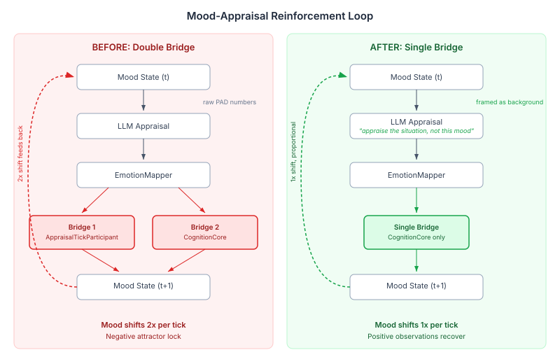

# The Bridge That Crossed Twice

*Continues from [The Stage That Couldn't Hear the Last One](2026-11-13-mdp01-the-stage-that-couldnt-hear.md).*

The crossTickTrajectory eval runs ten ticks through a character's day. Mild compliment, design review, deadline rejection, collaborative recovery, project exceeds expectations. A trajectory that should arc: positive start, negative dip, proportional recovery. The eval judge scored it 2.3 out of 5 and wrote a sentence that stopped me cold:

> "The system locked into a negative mood basin at tick 4 and then reinterpreted every subsequent observation — including objectively positive ones — through that fixed lens."

Tick 10 was a collaborative breakthrough. The system felt joy at 0.23 — barely above the mild compliment at tick 2. Tick 11 was unambiguous approval: "exceeded expectations, ahead of schedule." The system produced zero joy and a narrative about suffocating. Something was amplifying negative mood beyond what the appraisal warranted, and nothing was letting it recover.

## Two Methods, One Effect

The cognitive pipeline bridges appraisal emotions to mood via a simple mechanism: take the intensity-weighted PAD average of all emotions produced by the appraisal, create a `MoodSignal.DirectShift`, and record it with the mood orchestrator. The bridge code is fifteen lines — three stream operations, a clamp, and a record call.

Two different classes contained that code. Both were correct in isolation.

`AppraisalTickParticipant` ran `bridgeToMood(result, context)` at the end of its `tick()` method. This was natural — the participant produces the appraisal result, and bridging to mood is part of processing that result. It ran during `CognitionCore.runCustomParticipants(DERIVED)`.

Then `CognitionCore` called `bridgeAppraisalToMood(r, agentId, tenantId)` when it read back the same result via `appraisalParticipant.currentResult()`. This was also natural — CognitionCore orchestrates the tick lifecycle, and bridging appraisal to mood is part of that orchestration. It ran twenty lines later in the same method.

Same emotions. Same PAD average. Same mood signal. Recorded twice. Every appraisal pushed mood twice as hard as intended.

```java
// AppraisalTickParticipant.tick() — line 195, during DERIVED phase
bridgeToMood(result, context);

// CognitionCore.tick() — line 352, after reading the same result back
bridgeAppraisalToMood(r, agentId, tenantId);
```

Both methods were identical: intensity-weighted PAD average, clamped to [-2, 2], recorded as `"appraisal-emotions"`. Neither knew the other existed.

## The Reinforcement Loop

Double bridging alone would just make mood swings larger. What made it catastrophic was the feedback loop.



The LLM appraisal strategy includes the current mood in its prompt: `"Current mood: pleasure=-0.40, arousal=0.60, dominance=-0.30"`. Raw numbers, no framing, no baseline context. When mood is negative, the LLM reads those numbers and anchors its appraisal accordingly — even when the observation describes something objectively positive.

The reinforcement chain:

1. Tick 4 produces negative appraisal (design rejected). FEAR and SHAME emotions.
2. **Two bridges** record the same mood signal. Mood shifts -0.6 instead of -0.3.
3. Mood decay uses a 4-hour time constant. Between sub-second ticks, decay is negligible.
4. Tick 5: LLM sees `pleasure=-0.60`. Appraises neutral observation negatively.
5. Negative appraisal produces more negative emotions. Two bridges shift mood further.
6. By tick 8, mood is locked at the displacement floor. Positive observations can't generate enough positive emotion to overcome the doubled negative signal from previous ticks.

This is a classic positive feedback loop — but one where both amplifying elements were individually correct and passed all their unit tests.

## Why Unit Tests Couldn't See It

`AppraisalTickParticipant` had 19 passing tests. `CognitionCore` had its own test suite. `MoodOrchestrator` had 20 tests including decay verification. `EmotionMapper` had 19 tests. Every component was correct.

The double bridge was invisible to any single-component test because:

- `AppraisalTickParticipant` tests used mocked mood orchestrators. The bridge call recorded a signal, the mock accepted it, the test verified the signal was correct. It couldn't know CognitionCore would record the same signal again.
- `CognitionCore` tests that used mocked participants never ran the real `AppraisalTickParticipant.tick()`, so only CognitionCore's bridge fired. The mock returned the result; the bridge was correct for that single call.
- No test ran both the real participant *and* CognitionCore's post-processing on the same tick.

The only thing that could surface this was a multi-tick evaluation that scored cross-stage coherence — which is exactly what `crossTickTrajectory` does. And it reported 2.3/5 with a precise diagnosis of the symptom, without knowing the mechanism.

## The Fix Was Two Things

**One line removed.** `AppraisalTickParticipant.bridgeToMood(result, context)` at line 195 was the duplicate. CognitionCore's bridge is the canonical location — it's where all other appraisal-to-mood and appraisal-to-drive wiring lives, and it works correctly with mocked participants in tests. The capacity frustration bridge (a different call to the same method, producing different emotions from search budget gaps) was preserved — it has no CognitionCore equivalent.

**Ten words added.** The mood injection in `LlmAppraisalStrategy.buildUserMessage()` changed from:

```
Current mood: pleasure=-0.40, arousal=0.60, dominance=-0.30
```

to:

```
Current mood (background — appraise the situation itself, not this mood):
pleasure=-0.40, arousal=0.60, dominance=-0.30
```

The parenthetical tells the LLM that mood is context, not the event being appraised. Without it, negative PAD values anchored the LLM toward negative appraisals regardless of what actually happened. With it, a collaborative breakthrough gets appraised as a collaborative breakthrough — even when the character was in a bad mood beforehand.

## What This Teaches

Duplicate side effects are harder to find than duplicate logic. If two methods compute the same value, a reviewer might notice the redundancy. But if two methods *do* the same thing — each recording a mood signal as a side effect of processing the same data — the duplication is invisible unless you trace the full call graph. Each method's code reads as correct because it *is* correct. The bug is in the composition, not the components.

Emergent feedback loops are the most dangerous class of pipeline bug. Each individual connection — mood feeds appraisal, appraisal feeds mood — is architecturally sound. The problem is that the doubled bridge turns a stable feedback loop into an unstable one. The system has enough damping to handle a single bridge (mood decay, bounded displacement). It doesn't have enough damping to handle a doubled bridge, because the doubling was never part of the design.

Multi-tick evaluation is the only tool that catches this. Single-tick tests verify that the pipeline produces the right output for a given input. Multi-tick evaluation verifies that the pipeline's output at tick N doesn't poison its input at tick N+1. The crossTickTrajectory judge scored 2.3 and described the exact symptom — "negative mood basin" — without knowing the mechanism was a duplicated bridge. That's what good evals do: they surface symptoms precisely enough that the mechanism becomes findable.
