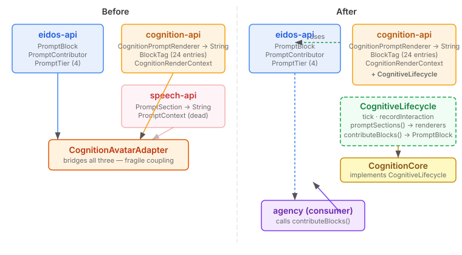

# The Interface That Was Already There

Three repos. Three prompt abstractions. Same five methods, different names.

eidos-api has `PromptBlock` — a typed prompt fragment with a tier, a tag, a salience score, and content. `PromptContributor` produces blocks. `PromptAssembler` collects them. It's the richest model of the three.

cognition-api has `CognitionPromptRenderer` — a functional interface that takes a render context and returns a nullable string. Twenty-four renderers produce the cognitive state that colours an agent's responses: mood, drives, beliefs, goals, appraisal, curiosity, attention. `BlockTag` orders them across six internal tiers with numeric ordinals.

speech-api in agency has `PromptSection` — identical to `CognitionPromptRenderer` but with different method names. And `PromptContext` — identical to `CognitionRenderContext` minus one field. Both are dead in production. The only code that actually runs uses the cognition-api types directly.

The bridge between all three is `CognitionAvatarAdapter` in agency-core. It resolves a descriptor from eidos, iterates cognition renderers, string-concatenates their output into a speech assembler's system prompt, and converts between two context types that carry the same three fields. It works, but it's fragile — three type systems for one concept.



The fix wasn't to merge the types or force one module to adopt another's interface. The fix was to notice that `CognitionCore` already implemented everything the bridge needed — five methods, all public, all matching the lifecycle pattern agency was already calling through the adapter.

`CognitiveLifecycle` is a 44-line interface in cognition-api. Four lifecycle methods — `initialize`, `tick`, `evaluateProactive`, `recordInteraction` — extracted from agency's `AvatarCognition` minus the speech-specific `wrapAssembler`. Plus `promptSections()`, which CognitionCore already exposed. Plus one default method: `contributeBlocks()`.

That default method is the bridge. It iterates `promptSections()`, calls `render()` on each, and wraps non-null results into `PromptBlock(COGNITIVE, tag, 0f, content)` — the eidos type. Ten lines. No branching. The tag comes from `BlockTag.name()`. The tier is always `COGNITIVE`. The salience is zero for now — a future extension point.

```java
default List<PromptBlock> contributeBlocks(CognitionRenderContext context) {
    var blocks = new ArrayList<PromptBlock>();
    for (var renderer : promptSections()) {
        try {
            var content = renderer.render(context);
            if (content != null && !content.isBlank()) {
                var tag = renderer.blockTag();
                var tagName = tag != null ? tag.name() : renderer.getClass().getSimpleName();
                blocks.add(new PromptBlock(PromptTier.COGNITIVE, tagName, 0f, content));
            }
        } catch (Exception e) { }
    }
    return List.copyOf(blocks);
}
```

The key design decision was keeping `CognitionPromptRenderer` returning `String`. The alternative — changing all 24 renderers to return `List<PromptBlock>` — would have pushed eidos concerns into every cognitive section for no internal benefit. Mood doesn't care about prompt tiers. Drives don't care about salience scores. The renderers know their content and their tag. The bridge knows how to wrap that into the representation the assembler expects.

This is the bridge adapter pattern at its smallest useful scale: two type systems, one default method, zero changes to existing implementations.

`CognitionCore implements CognitiveLifecycle` is a one-line change. The class already had every method. We added two thin bridge overloads — a simplified `tick(agentId, tenantId, activeSubjects)` that delegates to the full tick using the cached descriptor, and a 5-param `recordInteraction` that delegates to the 6-param version with null impact. That's it.

The tier mapping question was whether eidos's four `PromptTier` values (IDENTITY, COGNITIVE, COMMAND, CONVERSATION) needed extending to cover cognition's six internal tiers (Identity 100s, State 200s, Knowledge 300s, Strategy 400s, Signals 500s, Stimulus 900s). They don't. Those six tiers are an internal ordering concern — which cognitive section appears before which in the rendered prompt. The assembler doesn't need to distinguish State from Knowledge at the tier level. `PromptTier.COGNITIVE` plus a tag string carries all the information an external consumer needs. BlockTag preserves the sub-ordering internally.

What this opens up: agency can now call `CognitiveLifecycle.contributeBlocks()` directly instead of manually iterating renderers and string-concatenating. `CognitionAvatarAdapter` simplifies from a three-way bridge to a thin wrapper around the speech-specific `wrapAssembler`. The dead types in speech-api — `PromptSection`, `PromptContext`, the duplicate `AssembledPrompt` — can be deleted. That's the downstream work in agency, not neocortex's concern, but this interface is what makes it possible.

The pattern generalises. Any module that produces structured prompt contributions — cognitive, conversational, tool-oriented — can implement `PromptContributor` or expose a `contributeBlocks()` equivalent. The assembler collects blocks, sorts by tier, renders. Each contributor stays focused on its domain. The prompt representation is the shared contract, not the rendering logic.
